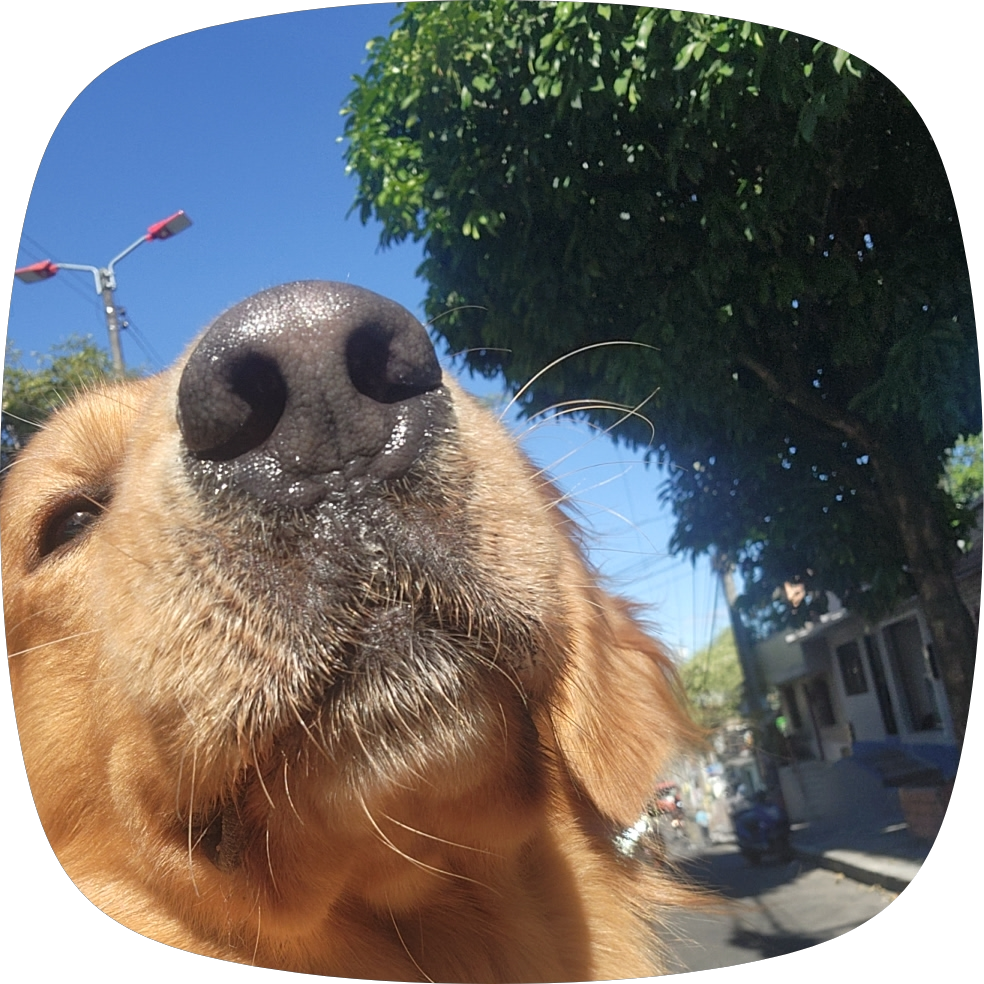

::: {.portfolio}
::: {.hero #inicio}
::: {.hero__content}
::: {.hero__kicker}
Estudiante de Matemáticas con énfasis en Estadística
:::

# Nicolás Díaz

::: {.hero__subtitle}
Interesado en entender, modelar y comunicar ideas con datos. Me gusta pasar de la teoría matemática a soluciones prácticas, con claridad y rigor.
:::

::: {.hero__actions}
[Ver proyectos](#proyectos){.btn .btn--primary}
[Sobre mí](#sobre-mi){.btn .btn--ghost}
[GitHub](https://github.com/nfdiazg8){.btn .btn--ghost}
:::
:::

::: {.hero__media}
::: {.hero__frame}
{.hero__photo .hero__photo--hidden onerror="this.classList.add('hero__photo--hidden'); this.nextElementSibling.classList.remove('hero__initials--hidden');" alt="Foto de Nicolás Díaz"}
::: {.hero__initials .hero__initials--hidden}
ND
:::
:::
:::
:::

::: {.section #sobre-mi}
::: {.section__header}
::: {.section__kicker}
Sobre mí
:::

## Un enfoque práctico entre matemáticas y estadística
:::

::: {.section__body}
Busco construir un puente entre el razonamiento matemático y la toma de decisiones con datos. Me interesa la inferencia, la probabilidad y encontrar formas sencillas de explicar resultados complejos.

Siempre estoy aprendiendo, documentando lo que voy descubriendo y aplicándolo en pequeños proyectos que luego comparto aquí.
:::

::: {.section__aside}
::: {.aside__label}
Contacto
:::
[github.com/nfdiazg8](https://github.com/nfdiazg8){.aside__link}
:::
:::

::: {.section #proyectos}
::: {.section__header}
::: {.section__kicker}
Proyectos
:::

## Selección de repositorios
:::

::: {.projects}
<a href="https://github.com/nfdiazg8/proyecto-1" class="project-card" target="_blank" rel="noopener">
::: {.project-card__header}
::: {.project-card__index}
01
:::
::: {.project-card__arrow}
→
:::
:::

::: {.project-card__body}
<h3 class="project-card__title">Proyecto 1</h3>

::: {.project-card__desc}
Espacio listo para personalizar. Añade aquí una breve descripción de este repositorio cuando lo edites.
:::
:::

::: {.project-card__footer}
GitHub Repository
:::
</a>

<a href="https://github.com/nfdiazg8/proyecto-2" class="project-card" target="_blank" rel="noopener">
::: {.project-card__header}
::: {.project-card__index}
02
:::
::: {.project-card__arrow}
→
:::
:::

::: {.project-card__body}
<h3 class="project-card__title">Proyecto 2</h3>

::: {.project-card__desc}
Espacio listo para personalizar. Añade aquí una breve descripción de este repositorio cuando lo edites.
:::
:::

::: {.project-card__footer}
GitHub Repository
:::
</a>

<a href="https://github.com/nfdiazg8/proyecto-3" class="project-card" target="_blank" rel="noopener">
::: {.project-card__header}
::: {.project-card__index}
03
:::
::: {.project-card__arrow}
→
:::
:::

::: {.project-card__body}
<h3 class="project-card__title">Proyecto 3</h3>

::: {.project-card__desc}
Espacio listo para personalizar. Añade aquí una breve descripción de este repositorio cuando lo edites.
:::
:::

::: {.project-card__footer}
GitHub Repository
:::
</a>
:::
:::

::: {.footer}
::: {.footer__row}
::: {.footer__brand}
Nicolás Díaz
:::
::: {.footer__meta}
© 2026 · Hecho con Quarto
:::
:::
::: {.footer__row}
::: {.footer__meta}
[github.com/nfdiazg8](https://github.com/nfdiazg8)
:::
:::
:::
:::
